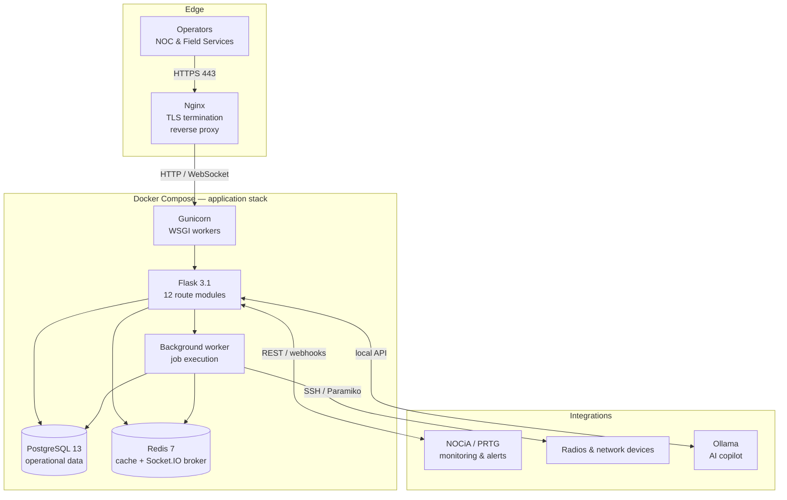
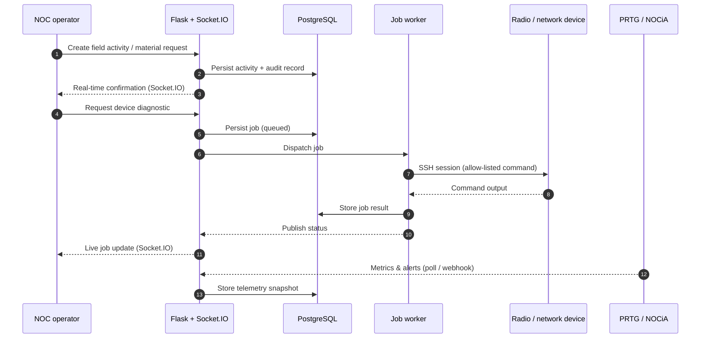
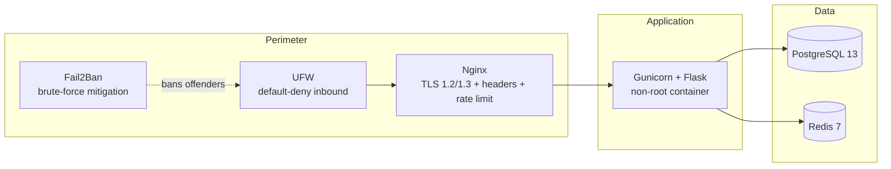

# NEXUS — NOC & Field Services Operations Platform

**Engineering case study** · Architecture, operations and security for a telecom
network operations center (NOC) and field-services platform.

> **Confidentiality note.** This repository is documentation only. The production
> codebase is private. No proprietary source code, customer data, internal
> domains, hostnames or IP addresses are published here. Screenshots under
> `docs/screenshots/` are sanitized before publication.

---

## 1. The problem

Network operations and field-service teams at a regional telecom operator
worked from a patchwork of spreadsheets, chat messages and disconnected tools:

- **No single source of truth** for network material inventory and field activity.
- **Manual, repetitive workflows** for job dispatch, material withdrawal and
  activity logging.
- **Slow incident response** — no unified, real-time view of equipment status.
- **Fragmented security visibility** — firewall, brute-force bans and container
  logs were inspected ad hoc, without a repeatable routine.
- **Manual device access** — engineers opened SSH sessions to radios and network
  equipment one host at a time.

## 2. The solution

NEXUS: an operational ERP for the NOC and Field Services, delivered as a
containerized web platform.

| Capability | What it does |
|---|---|
| Activity & material control | Jobs, equipment withdrawal/returns and activity logging with a full audit trail |
| Real-time operations | Socket.IO pushes job and status updates to operators |
| Monitoring integration | PRTG / NOCiA metrics and alerts surfaced inside the platform |
| Network automation | SSH command execution on radios and network devices via Paramiko |
| AI copilot | Local LLM (Ollama) assists with operational queries — data stays on-premises |
| Security observability | UFW, Fail2Ban and container log analysis in one CLI dashboard |

## 3. Architecture

### 3.1 Container topology

### 3.2 Operational flow

### 3.3 Security perimeter

## 4. Engineering metrics

| Dimension | Value | Why it matters |
|---|---|---|
| Route modules (blueprints) | **12** | Domain isolation: each operational area owns its routes and tests |
| Docker services | **5** | Reproducible deployment: edge proxy, application, worker, database, cache |
| Automated tests | **200+ pytest** | Regression safety across module boundaries |
| Real-time transport | **Socket.IO** | Operators see job/material status without page reloads |
| Relational database | **PostgreSQL 13** | Transactional integrity for inventory and audit records |
| Cache / broker | **Redis 7** | Low-latency reads and cross-worker Socket.IO messaging |
| Device automation | **SSH / Paramiko** | Read-only, allow-listed commands instead of manual sessions |

## 5. Reliability & observability

- **Health and status endpoints** feed uptime checks and dashboards.
- **Structured logs** from every container, scanned for error patterns.
- **CLI operations dashboard** aggregates UFW status, Fail2Ban jails, container
  health, CPU/memory and recent log errors into a single read-only snapshot.
- **Alerting integration** via PRTG / NOCiA so network events reach the same
  operational workflow as field activities.

## 6. Engineering decisions & trade-offs

1. **Modular monolith instead of microservices.** A small team cannot afford the
   operational overhead of a service mesh, distributed tracing and multi-repo
   releases. Twelve blueprints keep boundaries explicit while shipping as one
   unit with one transactional database.
2. **Redis for both cache and Socket.IO broker.** One dependency, one failure
   domain, one thing to monitor.
3. **Threaded Gunicorn workers.** Operational workloads are I/O-bound (database,
   SSH, HTTP integrations); threads avoid the complexity of async workers.
4. **Allow-listed, read-only device commands.** Automation must never become a
   remote shell. The command surface is explicit and auditable.
5. **On-premises AI.** The copilot runs on Ollama locally, so operational data
   never leaves the network.
6. **TLS termination at the edge.** The Flask app is never exposed directly;
   Nginx owns certificates, headers and rate limits.

## 7. Security model

- UFW with default-deny inbound; only 80/443 exposed publicly.
- Fail2Ban jails on SSH and authentication endpoints.
- TLS 1.2/1.3 only, HSTS and hardening headers at the proxy.
- Least-privilege SSH accounts for device automation.
- Audit trail on material movements and job state transitions.
- Secrets provided via environment variables, never committed.

## 8. Business impact

- **One operational view** replaces spreadsheets and chat threads.
- **Faster incident handling** — device diagnostics are triggered from the
  platform and results arrive in real time.
- **Traceable inventory** — every withdrawal and return is auditable.
- **Lower cognitive load** for on-call staff: one dashboard covers perimeter,
  containers and application errors.

## 9. Roadmap

- CI/CD with automated tests on every pull request.
- Infrastructure as code (Terraform / Ansible) for host provisioning.
- Prometheus + Grafana for time-series metrics and alert rules.
- Granular RBAC and SSO.
- Managed database migrations (Alembic) and blue-green deploys.

## 10. Stack

Python · Flask 3.1 · Gunicorn · Nginx · PostgreSQL 13 · Redis 7 · Socket.IO ·
Docker Compose · Paramiko · Ollama · pytest · Bash

## Reference implementation

A clean-room boilerplate reproducing these patterns without any proprietary
code lives at [flask-microservice-boilerplate](https://github.com/R0pr3/flask-microservice-boilerplate).

## Confidentiality

All production repositories are private. This case study intentionally contains
no source code, credentials, customer data, internal domains or real IP
addresses. Sanitized screenshots live in `docs/screenshots/`.
